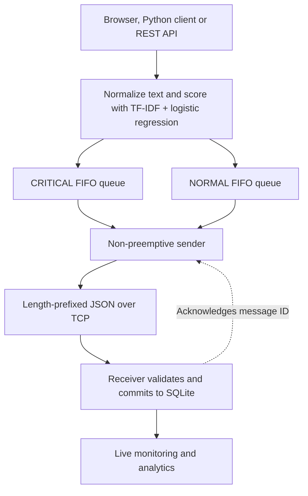

<div align="center">

# NetSense

**Intelligent Message Priority System for Critical Network Communication**

A critical alarm just joined the queue. What gets sent next?


[Quick start](#quick-start) · [Live demo](#live-demo) · [Measured results](#measured-results) · [Project layout](#project-layout)

</div>

## Two messages, one sender

| Message | Predicted priority |
| --- | --- |
| “Good morning, shift handover at 9 AM.” | `NORMAL` |
| “Emergency: patient in bed 4, heart rate critical.” | `CRITICAL` |

If both messages are waiting, NetSense picks the emergency first. If the handover is already in flight, it finishes before the emergency starts. Messages keep their arrival order within each priority class.

The scheduling decision happens in the sending application’s middleware before NetSense writes to the TCP connection. The receiver commits the message to SQLite and acknowledges its ID. One dashboard lets you follow that path from prediction to receipt.

## How a message moves



## Quick start

Install **64-bit Python 3.12**. Run these commands from the folder containing `app.py` and `requirements.txt`.

<details open>
<summary><strong>Windows · PowerShell</strong></summary>

```powershell
py -3.12 -m venv .venv
.\.venv\Scripts\python.exe -m pip install -r requirements.txt
.\.venv\Scripts\python.exe app.py
```

</details>

<details>
<summary><strong>Linux or macOS</strong></summary>

```bash
python3.12 -m venv .venv
.venv/bin/python -m pip install -r requirements.txt
.venv/bin/python app.py
```

</details>

Open [http://127.0.0.1:5000](http://127.0.0.1:5000). The default configuration sends messages through a real local TCP connection. NetSense initializes SQLite on startup and ships with a trained model.

## Live demo

1. **Send an alarm.** Open **Send message**, select the emergency example and submit it. The confirmation shows the classification, model score and message ID.
2. **Follow the receipt.** Open **Live monitoring** and click the message ID to inspect its timestamps, classification time, queue wait and delivery latency.
3. **Create a backlog.** Open **Traffic simulator** and start a mixed run with **32 messages**, **25% critical examples**, a **15 ms arrival interval**, and **120 ms service pacing**. Watch the waiting queues and compare arrival and delivery order.
4. **Compare policies.** Click **Compare FCFS and priority** to replay the same classified workload under both policies in a simulation. Inspect the average critical delay and maximum normal wait.
5. **Inspect the model.** Open **ML model** for the held-out confusion matrix and the threshold control. **Analytics** shows measured traffic separately from the simulated comparison.

Use the [faculty demo guide](docs/DEMO_GUIDE.md) for the full walkthrough.

## Measured results

The benchmark ran separate sender and receiver processes on one computer. Each policy delivered and acknowledged all 32 messages.

| Mean queue wait | First-come, first-served | NetSense priority |
| --- | ---: | ---: |
| Critical messages | 421.4 ms | 92.5 ms |
| Normal messages | 371.9 ms | 479.8 ms |

In this run, critical messages waited **78% less** on average. Normal messages waited **107.9 ms longer** on average. Strict priority makes that trade-off visible under load.

The logistic regression model correctly classified **66 of 72** held-out synthetic examples at a threshold of **0.45**. It caught all **36 critical examples** and incorrectly flagged **6 normal examples**. The corpus covers hospital, disaster-response and factory scenarios. These results describe an academic prototype evaluated on synthetic English messages.

Ten automated tests passed. Physical two-computer LAN and full browser verification are pending. See the [test report](docs/TEST_REPORT.md) and [benchmark data](docs/benchmark.json).

## Verify or run two nodes

With the virtual environment active, run:

```bash
python -m unittest discover -v
python -m scripts.compare --output local-benchmark.json
python -m scripts.configure_pair
```

In separate terminals, start Node B with `python app.py --config config/node-B.json`, then Node A with `python app.py --config config/node-A.json`. Send from [Node A](http://127.0.0.1:5001) and watch the receipt on [Node B](http://127.0.0.1:5002). The [LAN guide](docs/DEMO_GUIDE.md#5-physical-lan-verification) documents the acceptance procedure for two physical machines.

## Project layout

| Path | What it contains |
| --- | --- |
| [`app.py`](app.py) | Application entry point |
| [`netsense/`](netsense/) | TCP transport, classifier, scheduler, API and storage |
| [`ml/`](ml/) | Dataset generation, model training and evaluation |
| [`dashboard/`](dashboard/) | Flask templates, styles and browser scripts |
| [`tests/`](tests/) | Automated transport, scheduling and console checks |
| [`docs/`](docs/) | Architecture, technical reference and demo guide |

## Project team

**Suraj Rathod · Vishu Attri · Prabal Singh Bais**  
Guided by **Mr. Shivaji Patil**  
Department of Information Technology, MIT Academy of Engineering, Alandi, Pune  
Data Communication Minor Project · 2026–2027
